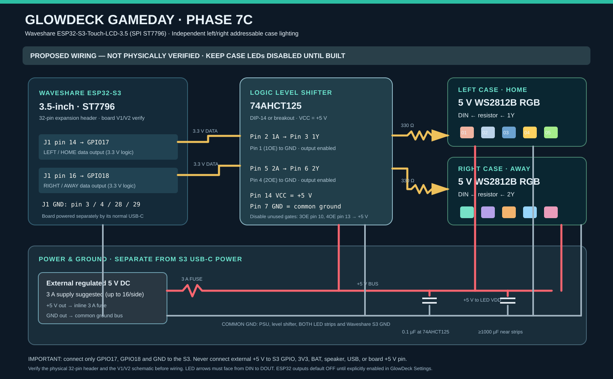

# Phase 7C — Left/right addressable LEDs for the S3 GameDay case

**State: firmware and wiring design only — physical assembly and tests pending.**
The user has not built the enclosure or attached LED strips. Do **not**
describe Phase 7C as hardware-validated, and do not enable the outputs yet.

[Open full editable wiring diagram (SVG)](assets/s3_phase7c_case_led_wiring.svg)

## Purpose and event behavior

Two **independent** addressable RGB strips illuminate the sides of the
case, based on the NHL primary-color palette already used by GameDay.
With the display facing the viewer, **LEFT = HOME**, **RIGHT = AWAY**.
The case LEDs share NHL event detection but do not depend on any
external WLED controller.

| Eligible event | LEFT / HOME | RIGHT / AWAY |
| --- | --- | --- |
| HOME goal in **followed or armed** live game | Home primary color: strobe then chase | Existing effect unchanged |
| AWAY goal in followed/armed live game | Existing effect unchanged | Away primary color: strobe then chase |
| Verified home PP in armed/followed game | Home color breathing pulse | Normal/other effect |
| Verified away PP | Normal/other effect | Away color breathing pulse |
| Armed game starts | Home color alternates | Away color alternates |
| Armed game reaches final | Winning team's side twinkles in its actual primary color | Other side's effect is unaffected |
| Idle/disabled | OFF | OFF |

Goal flashes override that **same side's** PP pulse temporarily; when the
goal animation expires, a still-verified power play resumes. GOAL effects
on both sides can run simultaneously. PP data must be fresh, confirmed by
the existing verified NHL penalty/situation logic; pulled-goalie events
alone must **not** trigger the case LEDs. League-wide **display-only**
events are never allowed to turn on the case strips. The side output is
local and never sends a second WLED command or invokes a second horn.

The pure effects engine is bounded to **20 updates/second**, with two
strips of **1–16 pixels each**, default 8 each. Digital brightness
is limited to **1–128/255** (50% ceiling), but power circuitry must still
be sized for the strip's full theoretical current. The case effects use
WS2812B **RGB / GRB wire order**, not SK6812 RGBW or CYD rear-RGB pins.

## Official Waveshare header pins

This plan targets only **Waveshare ESP32-S3-Touch-LCD-3.5** with the
**SPI ST7796** and FT6336 capacitive touch, *not* the similarly named
**ESP32-S3-Touch-LCD-3.5B QSPI**, and not the ESP32-2432S028R CYD.

| Circuit | Waveshare ST7796 expansion header |
| --- | --- |
| HOME / left strip data output | **GPIO17, J1 physical pin 14** |
| AWAY / right strip data output | **GPIO18, J1 physical pin 16** |
| Logic reference / common GND | **J1 GND, physical pin 3, 4, 28 or 29** |
| Internal S3 USB power | USB-C, **separate from external strip supply** |
| LCD SPI | GPIO1/2/3/5, **do not reuse** |
| FT6336 / ES8311 I2C | GPIO8/7, **do not reuse** |
| ES8311 I2S speaker | GPIO12/13/15/16, **do not reuse** |

Source: [official V1/V2 Waveshare schematic and pinout](https://docs.waveshare.com/ESP32-S3-Touch-LCD-3.5/Resources-And-Documents)
and [official ST7796 product page](https://www.waveshare.com/esp32-s3-touch-lcd-3.5.htm).
**Confirm the physical PCB revision and matching schematic before
wiring or powering up.** Header physical pin numbers are **not**
GPIO numbers.

### Schematic / connection list

Use a **74AHCT125** 5 V logic-level buffer with separate gates for each
data stream. A resistor alone is *not* a level shifter.

| From | To |
| --- | --- |
| S3 J1 pin 14 / GPIO17 (3.3V DATA) | 74AHCT125 **pin 2 / 1A** |
| 74AHCT125 pin 3 / 1Y | **330–470 Ω** series resistor → HOME strip **DIN** |
| S3 J1 pin 16 / GPIO18 (3.3V DATA) | 74AHCT125 **pin 5 / 2A** |
| 74AHCT125 pin 6 / 2Y | **330–470 Ω** series resistor → AWAY strip **DIN** |
| 74AHCT125 pins 1/1OE and 4/2OE | **GND** (outputs enabled, active LOW) |
| 74AHCT125 pin 14 / VCC | Fused **external regulated 5V +** |
| 74AHCT125 pin 7 / GND | Shared external supply **GND** |
| Unused 3OE pin 10 / 4OE pin 13 | Tie to **+5V** (disable unused gates) |
| HOME / AWAY LED strip **5V/VDD** | External fused **5V +**, parallel branches |
| HOME / AWAY LED strip **GND/VSS** | External supply **GND**, parallel branches |
| S3 J1 GND pin | Same external supply **GND**, **not 5V** |
| Capacitor, 100 nF ceramic | 74AHCT125 VCC pin 14 ↔ GND pin 7, close to IC |
| Capacitor, ~1000 µF ≥6.3V electrolytic | 5V ↔ GND near **each** LED-strip input, **observe polarity** |

The data resistors go **between** level-shifter outputs and the first
strip DIN. Connect each LED strip in the arrow direction **DIN → DOUT**.
Keep 5 V, ground and data runs short; put the level shifter near the S3
and the series resistors close to strip DIN. Add strain relief, insulation
and removable connectors to the case design. Do not connect the external
5 V supply to the board's 5V header, 3V3, BAT, speaker connector,
GPIO17 or GPIO18. The **only external connections to the S3** in this
design are GPIO17, GPIO18 and common GND.

A 5 V WS2812B can draw **up to ~60 mA per RGB LED** at full white. Size
the fuse, wire and regulated 5 V supply for maximum possible demand,
*not* the current software brightness cap:
- **8 pixels/side (16 total):** 16 × 0.06 = **0.96 A** worst-case LEDs.
  A fused regulated **5 V / 2 A** supply leaves margin.
- **16 pixels/side (32 total):** 32 × 0.06 = **1.92 A** worst-case LEDs.
  A fused regulated **5 V / 3 A** supply leaves margin.
Use a suitable 5 V inline fuse on the external positive supply (e.g.
3 A for the suggested 5V/3A maximum configuration); select fuse and
wire gauge for your finished enclosure.

**Power-up:** Connect the strips' 5V and GND to their **external**
regulated supply; connect the S3 by USB-C and connect **common GND**.
Ensure the strip's 5V is available before enabling the outputs. Never
work on wiring while powered. If designing an internal rechargeable
battery supply, use a properly protected, current-rated 5 V boost
converter; do not drive the strips directly from the Li-ion battery or
the AXP2101 board output.

## Bill of materials for proposed enclosure

| Qty | Part | Notes |
| --- | --- | --- |
| 1 | Waveshare ESP32-S3-Touch-LCD-3.5 ST7796 | Existing, already running GameDay |
| 2 | 5 V WS2812B/SK6812 RGB (GRB) pixel strips | 8–16 pixels each; not RGBW |
| 1 | 74AHCT125 quad buffer, DIP-14 or tested breakout | 3.3V → 5V data level translation |
| 2 | 330–470 Ω, ¼ W resistors | One for each DIN line |
| 1 | 100 nF ceramic capacitor | At buffer supply |
| 2 | 1000 µF, ≥6.3 V electrolytic capacitors | At LED input 5V/GND |
| 1 | Regulated fused 5 V 2–3 A DC supply | Separate from S3 USB input; size for full current |
| 1 | Inline fuse and fuse holder | Rating sized to supply / wiring |
| As needed | 3-conductor connectors, insulated wire, strain relief, diffuser | Include service loops |
| 1 | 3D-printed / fabricated GameDay enclosure | Diffused LEFT/HOME and RIGHT/AWAY windows |

## Firmware and web UI

- `include/S3CaseLedPolicy.h`: pure C++11 side-specific, timestamp-based
  strobe/chase, PP pulse, puck drop, final and RGB diagnostics.
- `include/S3CaseLedDriver.h`: lazy-initialized Adafruit NeoPixel
  (ESP32-S3 RMT), independent GPIO17/18 outputs, bounded 16 pixels/side,
  fixed RGB→GRB transport. `platformio.ini` dependency is **S3 only**.
- `src/main.cpp`: real followed/armed NHL score detection, fresh PP,
  armed game transitions, separate NVS preferences.
- Web **Settings → Case lighting · Phase 7C**: disabled by default;
  config controls for LED count, brightness, duration and event
  permissions, isolated per-side goal/PP and RGB preview, OFF.
- `GET /api/case-led`: reports settings, effect states, GPIO/header pins,
  and explicitly **physicalOutputVerified:false**.
- Authenticated `POST /api/case-led/config`: update preferences. To go
  from OFF to ON requires a `wiredConfirmed:true` field after the
  UI wiring confirmation. Saved `caseOn` remains **false** until then.
- Authenticated `POST /api/case-led/test`: diagnostic `mode` among
  `goal`, `pp`, `start`, `final`, `red`, `green`, `blue`, `off`;
  `side` is `home` or `away`, with optional `team` abbreviation.
  The test never changes followed games, NHL event log, WLED, horn,
  goal GIF, or NVS. It refuses while outputs are disabled.
- **CYD unchanged:** the old 2.8" CYD active-low rear LED and its
  GPIO pins remain completely separate; S3 case outputs are not the CYD
  rear LED flag.

## Release acceptance / physical test interval

**Now, before building the case:** merge only after host tests and both
CYD/S3 PlatformIO builds are green. Keep the checkbox OFF.
The new pins are **not driven at boot** on a fresh S3.

**When you have the case/strips:** verify header marking and correct
power/logic level on a meter. Connect 5 V strips, install a fuse, check
GND continuity, short circuits, LED DIN orientation and resistor
placement before power. Then open the S3 web dashboard, enable with
confirmation, and **Save**. Confirm RED→GREEN→BLUE in that order on
**each** side (historical CYD green/blue swap must not be carried over).
Run left goal, right goal and PP diagnostics. At low brightness, verify
only the chosen side responds, and both sides stay dark when OFF.
Then check real followed HOME/AWAY goals, PP, game start, final, horn,
goal GIF, WLED and scoreboard while simultaneously active.

**What CI cannot certify:** electrical pin availability on your exact
PCB revision, output voltage, 74AHCT125 behavior, strip color order,
actual current draw, reboot behavior with strip power missing, battery
charging or physical heat. Treat these as required acceptance tests
after assembly, not completed functionality.
